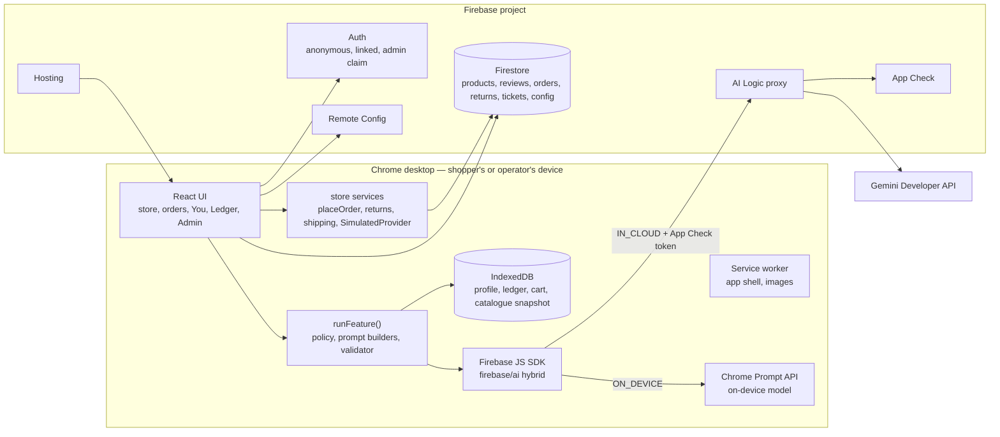
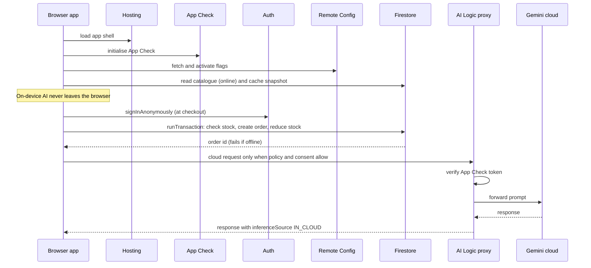
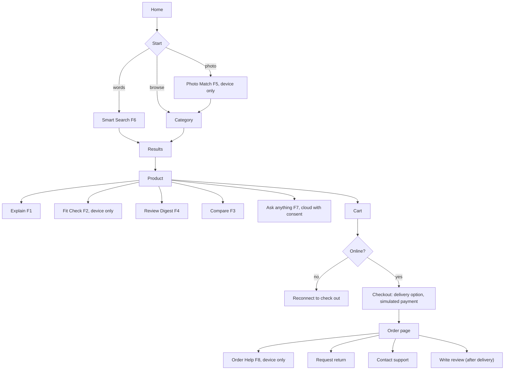
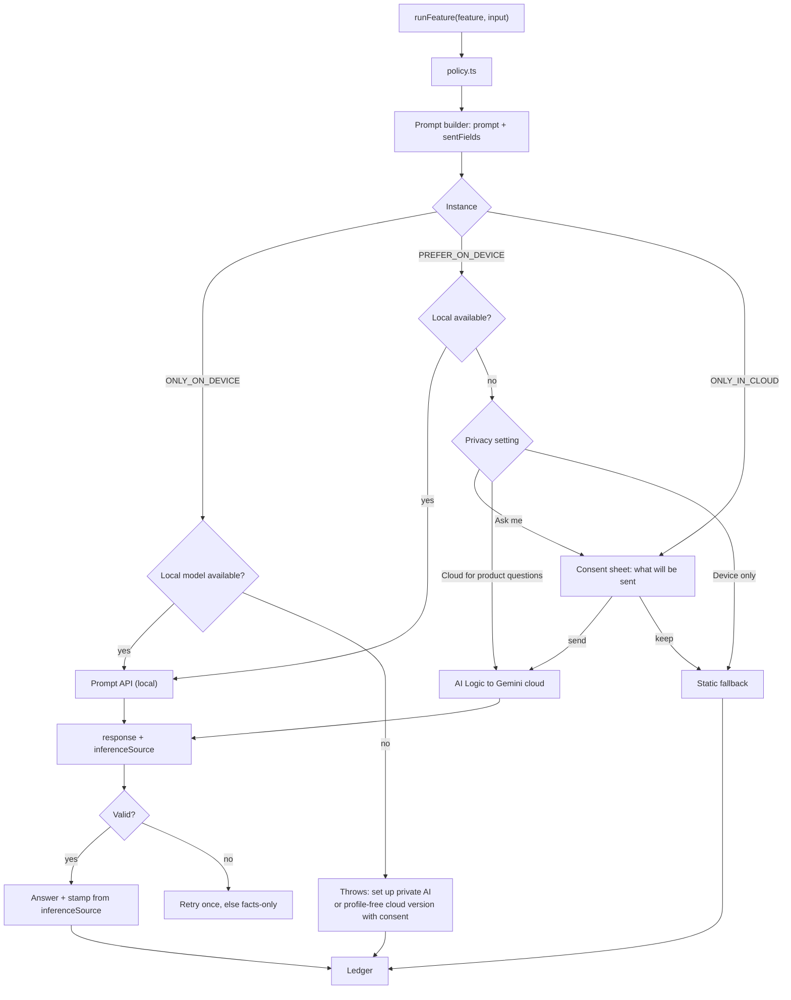
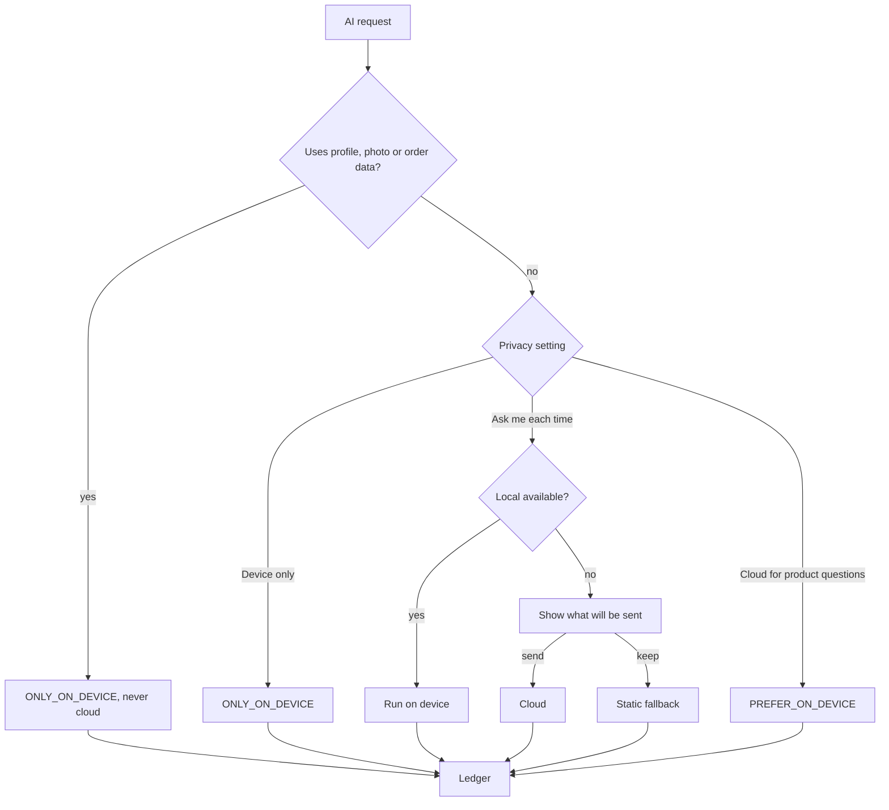
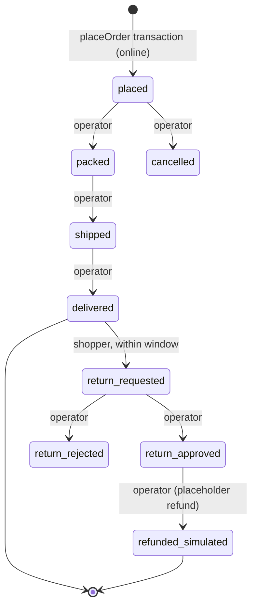

# HybridCart AI — Product, Experience and System Architecture

**Version:** 0.2 (refined, for review — no code written yet)
**Date:** 26 Nov 2026
**Hackathon:** #BuildHybridAI 2026 (Google / Devpost)
**Submission deadline:** 30 Nov 2026, 2:00 PM PT = **1 Dec 2026, 3:30 AM IST**
**Design canvas:** https://claude.ai/artifact/4pMF1ZUwbSP8184raTdDU5
**Status:** Planning document. Nothing here is proof of implementation.

### What changed since v0.1

| Change | Where |
|---|---|
| Platform and framework decision made explicit, with sources | §6 |
| Store capabilities added: orders and tracking, inventory, shipping, returns, customer support, admin, real reviews with moderation, payment placeholder | §3.4, §5, §7.4–7.7 |
| Two new AI features: Order Help (F8, device only) and Review Screening (F9, human approves) | §3.3 |
| Firestore data model and security approach | §7.4, §7.8 |
| Order lifecycle diagram added; system diagram updated | §8 |
| Warning colour darkened from `#B7791F` to `#9A6416` to pass text contrast | §4.3 |
| Mobile behaviour stated plainly: shop works, private AI needs a desktop | §4.8 |
| Firestore transactions are online-only; anonymous accounts and admin claims verified | §7 |
| Roadmap re-planned for the store scope | §9 |

---

## 0. How to read this document

Every important statement carries a source tag. Tags are never mixed inside one sentence.

| Tag | Meaning |
|---|---|
| **[Rules]** | Official rules — https://firebasehybridaihackathon.devpost.com/rules (read 26 Nov 2026) |
| **[Overview]** | Challenge page — https://firebasehybridaihackathon.devpost.com/ (read 26 Nov 2026) |
| **[FAQ]** | Official FAQ — https://firebasehybridaihackathon.devpost.com/details/faqs (read 26 Nov 2026) |
| **[FB-Hybrid]** | https://firebase.google.com/docs/ai-logic/hybrid/web/get-started |
| **[FB-Config]** | https://firebase.google.com/docs/ai-logic/hybrid/web/configuration-options |
| **[FB-Models]** | https://firebase.google.com/docs/ai-logic/models |
| **[FB-AppCheck]** | https://firebase.google.com/docs/ai-logic/app-check |
| **[FB-Struct]** | https://firebase.google.com/docs/ai-logic/generate-structured-output |
| **[FS-Tx]** | https://firebase.google.com/docs/firestore/manage-data/transactions |
| **[Auth-Anon]** | https://firebase.google.com/docs/auth/web/anonymous-auth |
| **[Auth-Claims]** | https://firebase.google.com/docs/auth/admin/custom-claims |
| **[Chrome]** | https://developer.chrome.com/docs/ai/prompt-api |
| **[TeamDoc]** | Uploaded `BuildHybridAI_2026_Complete_Summary.docx` |
| **[PastChat]** | Earlier chat "UI differences for mentor" (26 Nov 2026), where `hybrid-ai-shell` was built |
| **[Proposal]** | Design decision proposed here — open to change |
| **[UNVERIFIED]** | Not confirmed from an official source today. Check before relying on it. |

**Method note.** Official pages were read through a fetch tool that returns a condensed reading, not raw HTML. Some long Firebase pages were cut off; where a detail sat in the cut part it is marked **[UNVERIFIED]**.

**Not accessed**
- Devpost team-join link: returns a login page only. Team draft not read.
- Existing code: no project folder is connected to this session. Knowledge of `hybrid-ai-shell` (Next.js, `firebase@13.4.0`) comes only from **[PastChat]** and was not re-read.
- Firebase *Hybrid on Web — structured output* page: failed to load. On-device structured-output parameters are **[UNVERIFIED]**.
- Firestore security-rules syntax pages, Cloud Functions pricing, Firebase free-tier rate limits: not read in this session.

---

## 1. The hackathon — what is actually being asked

### 1.1 The challenge

Build a Gen AI app with **Firebase AI Logic** that runs prompts on-device when a local model is available and falls back to the cloud when it isn't. **[Overview]** All AI inference must go through Firebase AI Logic. **[FAQ]**

### 1.2 Requirements, classified

| # | Requirement | Class | Source |
|---|---|---|---|
| R1 | Gen AI app built with Firebase AI Logic | **Mandatory** | [Rules §6] |
| R2 | All AI inference through Firebase AI Logic, no direct model API calls | **Mandatory** | [FAQ] |
| R3 | At least one platform: Web (Chrome) with Gemini Nano 4, Android with Gemini Nano 4, or iOS with Apple Foundation Models, all via Firebase AI Logic | **Mandatory** | [Rules §6], [FAQ] |
| R4 | Native Windows/macOS apps don't qualify | **Constraint** | [FAQ] |
| R5 | App Check enabled (debug tokens accepted) | **Mandatory** | [Rules §6], [FAQ] |
| R6 | Use both on-device and cloud; judges score hybrid effectiveness | **Effectively mandatory to score** | [FAQ], [Rules §8] |
| R7 | New, or existing project significantly updated after 11 Nov 2026; disclose pre-existing code | **Mandatory** | [Rules §6], [FAQ] |
| R8 | App supports English | **Mandatory** | [Rules §6] |
| R9 | Runs consistently on intended platform; matches video and description | **Mandatory** | [Rules §6] |
| R10 | Text description: Firebase AI Logic usage, features, value proposition | **Mandatory** | [Rules §5–6] |
| R11 | Public GitHub/GitLab repo; all source, assets, setup instructions; Firebase AI Logic imported and called at runtime; open-source licence in About (Apache preferred) | **Mandatory** | [Rules §6], [FAQ] |
| R12 | YouTube video ≤ 3 min (only first 3 judged), public, English or English subtitles, shows app on target platform | **Mandatory** | [Rules §6] |
| R13 | Working link/demo/test build, free to test until judging ends; credentials in testing notes if login needed | **Mandatory** | [Rules §6], [FAQ] |
| R14 | No production API keys, live Google Cloud secrets, debug tokens, service-account keys, `.env`, confidential data or PII in repo/form/instructions | **Mandatory** | [Rules §6], [FAQ] |
| R15 | Hosted public URL | **Optional, strongly encouraged** | [Overview], [FAQ] |
| R16 | Remote Config, Firestore, Authentication | **Optional, encouraged** | [Overview] |
| R17 | Multi-platform | **Optional, preferred**; standout single-platform can win | [Overview], [FAQ] |
| R18 | First 30 s of video: who, problem, how Firebase AI Logic makes it work; show hybrid early | **Recommendation** | [FAQ] |
| R19 | No third-party logos or trademarks in the video | **Recommendation** | [FAQ] |

**Eligibility [Rules §3], [FAQ]:** age of majority; residence-based country exclusions (Belarus, Brazil, Crimea, Cuba, Iran, Italy, North Korea, Quebec, Russia, Sudan, Syria, other OFAC); no Google/Devpost employees or families; no Google/Devpost-funded projects; teams appoint a Representative. **Manual:** every listed teammate confirms eligibility.

### 1.3 Judging

Stage 1: pass/fail on requirements. Stage 2: four equally weighted criteria, 1–5 each, averaged; ties broken in this order. **[Rules §8]**

| Criterion | Official meaning (paraphrased) | How HybridCart answers it **[Proposal]** |
|---|---|---|
| Technological Implementation | Build quality and effective use of hybrid inference | A different, justified mode per feature; real `inferenceSource`; offline on-device path; every unavailable state handled |
| Design | Complete, coherent product, not a proof of concept | A working store: browse, decide, buy, track, return, get help |
| Potential Impact | Credible case for a real problem and audience | Careful buyers of technical products who won't hand over personal details |
| Quality of the Idea | Creative, non-obvious use of Firebase AI Logic | Personal data has a hard device boundary (`ONLY_ON_DEVICE`), proven per answer by a stamp and a ledger |

Judges may score from text, images and video alone without testing. **[Rules]**, **[FAQ]**

### 1.4 Firebase AI Logic on Web — verified facts

- On-device uses Chrome's Prompt API; cloud uses a Gemini API provider (Gemini Developer API recommended). **[FB-Hybrid]**
- Needs Firebase JS SDK **v12.5.0+** and **Chrome Desktop 139+** on the end user's machine. **[FB-Hybrid]**
- Modes via `getGenerativeModel(ai, { mode: InferenceMode.X })` **[FB-Config]**:

| Mode | Behaviour |
|---|---|
| `PREFER_ON_DEVICE` | On-device if available, else cloud |
| `ONLY_ON_DEVICE` | On-device if available, else throws |
| `PREFER_IN_CLOUD` | Cloud if available, else on-device |
| `ONLY_IN_CLOUD` | Cloud if available, else throws |

- `response.inferenceSource` = `ON_DEVICE` or `IN_CLOUD` (v12.5.0+). **[FB-Config]**
- Config is fixed per model instance; one instance per configuration. **[FB-Config]**, **[FAQ]**
- Default cloud model `gemini-3.5-flash-lite` (v13.0.0+), override with `inCloudParams.model`; `inCloudParams.generationConfig` accepted. **[FB-Config]**
- On-device options via `onDeviceParams.createOptions` (`expectedInputs`, `expectedOutputs`, `initialPrompts`). **[FB-Config]**
- `model.initializeDeviceModel(progressCallback)` should be called during/after a user interaction, before prompting; `ONLY_ON_DEVICE` waits for download, `PREFER_*` don't and fall back to cloud. **[FB-Hybrid]** (This corrects [TeamDoc] §21.)
- Firebase console AI monitoring has no data for on-device inference. **[FB-Hybrid]**

### 1.5 On-device capability limits (Web)

**Supported [FB-Hybrid]:** single-turn generation, streaming or not; text input; text + image (JPEG/PNG, max 9,216 tokens); structured output (JSON, enums).

**Not supported on-device [FB-Hybrid]:** multi-turn chat; other image formats; audio, video, PDF; image generation (all fall back to cloud in `PREFER_*`, throw in `ONLY_ON_DEVICE`); function calling, code execution, URL context, grounding; file URLs (use inline data); `countTokens` for hybrid; Gemini Live API and server prompt templates not supported for hybrid at all.

**Chrome requirements [Chrome]:** Windows 10/11, macOS 13+, Linux, ChromeOS on Chromebook Plus; not Chrome for Android or iOS. ≥22 GB free on the profile volume (model removed below 10 GB). GPU with more than 4 GB VRAM, or 16 GB+ RAM and 4+ cores. Unmetered network for first download only. Text output only. Languages: en, ja, es, de, fr. Not in Web Workers. Overflow drops oldest turns; failure raises `QuotaExceededError`. Chrome states no data is sent to Google or third parties when using the model.

### 1.6 Conflicts and gaps in official material

| # | Issue | Action |
|---|---|---|
| C1 | Chrome flag: [FB-Hybrid] names `#prompt-api-for-gemini-nano-multimodal-input`; [FAQ] says enable "Gemma 4 for Built-in AI" | **[UNVERIFIED]** Check `chrome://flags` on the demo machine; document what's there |
| C2 | Firebase says Chrome 139+; [Chrome] lists web Prompt API as "Intent to Ship, Chrome 148" | Test on current stable Chrome; state tested version in README |
| C3 | Naming: rules "Gemini Nano 4", Chrome "Gemini Nano", FAQ flag "Gemma 4" | Use the hackathon's wording in UI and video |
| C4 | On-device structured-output parameters | **[UNVERIFIED]** Day-1 spike |
| C5 | Prompt API context size not published | Cap inputs via Remote Config; measure in spike |
| C6 | Quota sprint deadline (25 Nov) passed | Use only billing-not-required models: `gemini-3.5-flash-lite` or `gemini-4-hydrogen` **[FB-Models]** |
| C7 | Free-tier rate limits not read | **[UNVERIFIED]**; retry 503 with backoff, check model name on 429/404 **[FAQ]** |

### 1.7 Hardware reality check

**[TeamDoc]** laptop: i5-13420H, 16 GB RAM, RTX 2050 4 GB VRAM. By **[Chrome]** the GPU route fails (needs more than 4 GB); the CPU route meets RAM and cores. Free disk unknown. Whether Chrome actually uses the CPU route there is **[UNVERIFIED]**. **[Proposal]** The whole store must work without the local model, and the video must be recorded on a machine where it does work.

---

## 2. The problem, refined

### 2.1 Breaking down the stated problems

| Stated problem | Underlying difficulty | Hybrid's role |
|---|---|---|
| Privacy | Good advice needs personal details; shoppers don't know where they go | Personal work runs `ONLY_ON_DEVICE` |
| Internet dependency | AI help disappears with weak signal | On-device works offline after download **[Chrome]**; app shell and catalogue must be cached separately; payments and order placement still need a network **[FS-Tx]** |
| Complex product information | Specs written for engineers; similar products hard to compare | Short single-turn explanations fit on-device **[FB-Hybrid]** |
| Limited personalisation | Personalisation vs privacy tension | Resolved by keeping the profile on the device |
| Transparency and control | No visibility of where processing happens | `inferenceSource` gives evidence per answer **[FB-Config]** |

**Crux [Proposal]:** privacy, personalisation and transparency are one problem — advice that knows you, without handing your details to a server, with proof. Connectivity and spec confusion are the conditions under which that advice is needed.

### 2.2 Refined problem statement [Proposal]

> People buying technical products online need advice that fits their own situation. Today that means sending personal details to a cloud AI, needing a stable connection, and trusting answers whose origin they can't see. So they over-share, get generic advice, or give up on the decision.
>
> HybridCart AI is a complete online store where personal context stays on the shopper's device. On-device Gemini Nano explains specs, checks fit against the shopper's own needs, reads their photos and answers questions about their orders. Cloud Gemini is used only for tasks the device can't do, only with non-personal content, and only with permission. Every AI answer shows where it was made and what was sent.

### 2.3 What makes it genuinely useful

1. AI never invents what the store owns: price, stock, delivery dates, order status come from Firestore; AI explains them.
2. Personalisation works with no account and no upload.
3. Answers are short and decision-shaped.
4. Every unavailable state has a next step.
5. The store is complete enough to trust: you can buy, track, return and get help.

---

## 3. Product strategy

### 3.1 Users [Proposal]

| Persona | Pain | What earns trust |
|---|---|---|
| Careful buyer (primary) | Spec overload, fear of a wrong choice | Plain answers tied to their needs, facts visible |
| Privacy-minded shopper | Won't create accounts or be profiled | Guest checkout; profile stays local; proof per answer |
| Low-connectivity shopper (on a laptop) | AI vanishes offline | Spec help and fit check work offline on a ready device |
| Store operator (secondary) | Needs to manage stock, orders, returns, reviews | A small admin area |

**Category [Proposal, Q2]:** personal and home electronics (audio, laptops/tablets, air and climate). Fictional products and brands only.

### 3.2 Where AI helps and where it must not

| Task | Approach |
|---|---|
| Browse, filter, price, stock, cart, checkout, order status, shipping options | **No AI.** Deterministic, from Firestore |
| Explain a spec, check fit, compare, summarise reviews, parse a search, read a photo, answer order questions, screen reviews | AI, per policy in §3.3 |
| Open-ended conversation | AI, cloud only, consent, no personal data |
| Moving money, changing an order, approving a review or refund | **Never AI.** Buttons and people |

### 3.3 AI features and routing policy [Proposal]

Firebase doesn't route by task complexity; the routing policy is ours. **[TeamDoc §6]**, **[FB-Config]**

| ID | Feature | Personal data? | Mode | If unavailable |
|---|---|---|---|---|
| F1 | Spec Explainer | No | `PREFER_ON_DEVICE` (subject to privacy setting) | Static glossary entry |
| F2 | Fit Check (JSON verdict) | **Yes**, profile | `ONLY_ON_DEVICE` | Set up private AI, or run a profile-free version in the cloud with consent |
| F3 | Compare 2–3 | Optional profile | `ONLY_ON_DEVICE` with profile; `PREFER_ON_DEVICE` without | Facts table only |
| F4 | Review Digest | No | `PREFER_ON_DEVICE` | Raw reviews |
| F5 | Photo Match (JPEG/PNG → attributes → catalogue filter) | **Yes**, photo | `ONLY_ON_DEVICE` | Manual filters |
| F6 | Smart Search (words → JSON filters → deterministic search) | No | `PREFER_ON_DEVICE` | Keyword search |
| F7 | Ask Anything (multi-turn) | Never attached | `ONLY_IN_CLOUD` + consent | "Needs a connection" / hidden in Device-only |
| **F8** | **Order Help** — answers "where is my order", "can I return this", "when will it arrive" from the order record and store policy | **Yes**, order and address | `ONLY_ON_DEVICE` | Order page with status timeline and "Contact support" form (human) |
| **F9** | **Review Screening** (admin) — enum `{publish_ok, needs_look}` + reason, shown to a human moderator | Customer text (not the operator's personal data) | `PREFER_ON_DEVICE` | Moderator reviews manually |

**Model instances:** `onDevicePersonal` (`ONLY_ON_DEVICE`), `preferLocalPublic` (`PREFER_ON_DEVICE`), `cloudConversation` (`ONLY_IN_CLOUD`), and `onDeviceStrict` (`ONLY_ON_DEVICE`, used for public features when the setting is Device only). **[FB-Config]**, **[FAQ]**

**Structured output dependency:** F2, F3, F5, F6, F9 rely on on-device JSON/enum output, which Firebase lists as supported **[FB-Hybrid]**; exact config is **[UNVERIFIED]** (C4). Fallback: strict line format in the prompt, parsed and validated by the app; invalid output is never shown.

### 3.4 Store capabilities [Proposal]

Added in v0.2. Each is real behaviour backed by Firestore unless marked **placeholder**.

| Capability | What the shopper or operator gets | Real vs placeholder |
|---|---|---|
| Payments | Checkout with a payment step | **Placeholder:** a `PaymentProvider` interface with a `SimulatedProvider` that takes no money. Stands in for a hosted payment checkout from a PCI-compliant provider. Reason: judges must test for free and no live secrets may be in the repo **[Rules §6]** |
| Order history and tracking | My orders list; order page with a status timeline | Real records. Status changes are made by the operator in admin; **no courier integration** (placeholder for carrier tracking) |
| Inventory | Stock shown, out-of-stock blocks purchase, stock reduced when an order is placed | Real, via a Firestore transaction **[FS-Tx]** |
| Shipping and delivery | Two delivery options with prices and estimated dates at checkout | Real options from a Firestore config document; values are sample data |
| Returns and refunds | "Request a return" on delivered orders within the policy window; return status | Real requests; **refund is simulated** (follows the payment placeholder) |
| Customer support | Order Help (F8, on-device) plus "Contact support" form that creates a ticket the operator answers | Real tickets; human replies |
| Admin | Stock edits, order status updates, returns decisions, review moderation, support tickets | Real, restricted by an admin claim **[Auth-Claims]**. Product creation/editing is out of scope (seed script instead) |
| Reviews and moderation | Customers who bought an item can review it; reviews start as pending; F9 suggests; a human publishes or rejects | Real. Seed reviews are labelled sample data |

### 3.5 Privacy controls in the journey [Proposal]

- One setting, three positions: **Device only**, **Ask me each time** (default), **Cloud for product questions**. Personal features never use the cloud in any position.
- Profile in IndexedDB; no account needed; "Delete my preferences".
- Before any cloud call, a sheet lists exactly what HybridCart will send. This list comes from our prompt builder, so the UI calls it "what HybridCart sends", not a Google guarantee. App Check is not anonymisation. **[TeamDoc §10]**, **[FB-AppCheck]**
- **Order data is personal.** Order Help (F8) runs `ONLY_ON_DEVICE`. Orders themselves are stored in Firestore because buying needs a server record; this is stated on the You page.

### 3.6 Communicating local vs cloud [Proposal]

Every AI answer carries a stamp filled from `response.inferenceSource`, never from the requested mode **[FB-Config]**: "Made on this device" (solid green border, laptop icon) or "Made by Gemini in the cloud" (dashed blue border, cloud icon). Opening it shows requested mode, actual source and what was sent.

### 3.7 Unavailable states [Proposal]

| State | What the user sees |
|---|---|
| Browser not supported | Store works; AI cards say on-device help needs Chrome on a computer; cloud option if allowed |
| Model downloadable | "Set up private AI" (needs ~22 GB free) → user gesture → `initializeDeviceModel` with progress **[FB-Hybrid]** |
| Downloading | Progress in header; public features may use cloud per setting |
| Offline, model ready | On-device features work; cart works; checkout, returns and support form say "Reconnect to…" (Firestore transactions fail offline **[FS-Tx]**) |
| Offline, model not ready | Browse cached catalogue; AI cards explain what's needed |
| Cloud blocked by setting | Personal features on-device; F7 hidden |
| Cloud 429/503 | "Gemini is busy. Try again in a moment." Backoff on 503 **[FAQ]** |
| Context too long | Trim inputs, retry once; else ask to compare fewer |
| Invalid output | One retry; else facts-only message |
| Out of stock at checkout | Transaction fails → item marked unavailable, rest of order kept |

### 3.8 Value proposition

*Advice that knows you, without your details leaving your device* — in a store you can actually buy from, track and return to.

---

## 4. Creative direction

Visualised on the design canvas (link at top). Guidance applied from the `frontend-design` skill: one point of view, boldness in one place, no generic defaults.

### 4.1 Personality
A knowledgeable shop assistant who keeps your notes in your pocket. Calm, exact, confident. Sentence case. "Fits your room." "Made on this device."

### 4.2 The one memorable thing
**The processing stamp**, borrowed from receipts and parcels. Two shapes, two colours, two icons. Everything else stays quiet.

### 4.3 Colour [Proposal]

| Name | Hex | Role |
|---|---|---|
| Slate Ink | `#1F2A30` | Text, primary actions |
| Fog | `#F2F4F3` | Page ground |
| Paper | `#FFFFFF` | Product and answer surfaces |
| Lichen | `#4E7A5A` | Made on this device — only |
| Harbour | `#2D5F8B` | Made in the cloud — only |
| Signal Amber | `#9A6416` | Consent, watch-outs (was `#B7791F`; failed text contrast on white by my calculation) |

Contrast figures are my calculations; re-check with a contrast tool during build.

### 4.4 Type [Proposal]
Familjen Grotesk (headings, product names, verdicts) and Atkinson Hyperlegible Next (body, answers), both from Google Fonts — **[UNVERIFIED]** licence check before shipping. Scale 13/16/20/25/31/39 px; body 16 px, line-height 1.5; answers ≤ 72 characters a line; tabular figures for prices.

### 4.5 Layout
12-column grid, 1200 px max, left-aligned. Product page split: facts (left) | For you (right). Listings use a varied list-and-image rhythm, not identical cards. Radius follows hierarchy: 0 images, 6 px controls, 12 px panels.

### 4.6 Imagery
Fictional products on plain grey sweeps; no brand logos or trademarks **[FAQ]**; placeholders labelled.

### 4.7 Motion
One moment: the stamp settling on a finished answer (150 ms), respecting `prefers-reduced-motion`. Streaming text as it arrives.

### 4.8 Responsive
Desktop: full experience. Tablet: For you stacks under facts. **Phone: the store works fully, but on-device AI does not** — Chrome for Android and iOS aren't supported by the Prompt API **[Chrome]**. Phone screens say private checks need a computer and offer cloud help with consent.

---

## 5. Information architecture

### 5.1 Site map [Proposal]

```
/                      Home: search (words or photo), categories, private-AI status
/c/:category           Category listing + filters
/search?q=             Results with editable filter chips (F6)
/p/:productId          Product: facts | For you (F1–F4, F7); reviews; write a review (buyers)
/compare?ids=          Compare 2–3 (F3)
/cart                  Cart (local; works offline)
/checkout              Address (sample data), delivery option, simulated payment
/orders                My orders
/orders/:orderId       Order: status timeline, Order Help (F8), request return, contact support
/you                   Preferences (device only), privacy setting, account linking (optional)
/ledger                Privacy ledger (could merge with /you — design shows them together)
/help                  Store policies: delivery, returns, privacy
/about-ai              How HybridCart uses on-device and cloud AI
/admin                 Operator area: stock, orders, returns, reviews (F9), tickets
```

### 5.2 Page responsibilities (new or changed in v0.2)

| Page | Why | Achieves | Interactions | States |
|---|---|---|---|---|
| Checkout | Turn a decision into an order | Choose delivery, place order | Address form, delivery option, simulated pay | Offline blocked; stock changed; validation errors; payment placeholder label |
| My orders | Find past purchases | See status at a glance | Open order | Empty ("Your orders will appear here"); loading; signed-out guest note |
| Order | Track and get help | Know where it is; return it; ask | Order Help (F8), request return, contact support | Return window closed; already returned; AI unavailable → timeline + support form |
| Help | Plain policies | Know the rules before buying | — | — |
| Admin | Run the store | Keep stock, orders, returns, reviews, tickets accurate | Edit stock, set order status, decide returns, publish/reject reviews, reply to tickets | Not authorised; empty queues; offline blocked |

Other pages are unchanged from v0.1 (Home, Category, Search, Product, Compare, Cart, You, Ledger, About AI).

### 5.3 Journeys

- **Primary:** Home → Smart Search → Product → Explain spec → Fit Check → Compare → Cart → Checkout (delivery option, simulated payment) → Order page.
- **After purchase:** Order page → "When will it arrive?" (F8, on-device) → later "Request a return".
- **Support:** Order page → Order Help can't answer → Contact support → ticket → operator replies in Admin → reply shown on Order page.
- **Review:** Delivered order → Write a review → pending → Admin sees F9 suggestion → moderator publishes → shown on Product.
- **Offline commute, Deep question, Control:** as v0.1.

---

## 6. Platform and framework decision

### 6.1 Platform: Web (Chrome desktop)

**Facts**
- Allowed platforms: Web (Chrome, web app or extension) with Gemini Nano 4; Android with Gemini Nano 4; iOS with Apple Foundation Models, all via Firebase AI Logic. **[Rules §6]**
- One platform is enough; multi-platform gets strong Grand Prize consideration; a standout single-platform app can win. **[Overview]**, **[FAQ]**
- A Best Web/Chrome App prize ($3,000) exists. **[Overview]**
- Web on-device needs Chrome on desktop; Chrome for Android/iOS not supported. **[Chrome]**

**Reasoning [Proposal]**
- The team's stack, the earlier sample and this design are web.
- With ~4.5 days left, a second codebase (Android/iOS) would split effort and weaken the "complete, coherent product" score.
- Trade-off accepted: phone users get the store and cloud help, not private checks.

### 6.2 Framework: React + Vite + TypeScript SPA on Firebase Hosting

**Facts**
- The Firebase SDK is an npm package (`npm install firebase`), not tied to a framework. **[FB-Hybrid]**
- On-device inference uses Chrome's Prompt API in the visitor's browser and isn't available in Web Workers. **[FB-Hybrid]**, **[Chrome]**

**Reasoning [Proposal]**
- AI calls must run client-side in the browser, so server rendering adds nothing to the AI features.
- A static SPA is the simplest thing to host and for judges to open.
- Vite is the team's stated direction.

**Condition (Q1):** `hybrid-ai-shell` was Next.js with static export **[PastChat]**. If, once read, it is substantial and working, keeping Next.js static export may be faster than porting. Decide after reading the code.

**Libraries [Proposal], each to be justified in an ADR:** `firebase` (≥13.x so the documented default cloud model applies **[FB-Config]**; ≥12.14.0 if limited-use App Check tokens are used **[FB-AppCheck]**), React Router, Zod (output validation), `idb` (IndexedDB). No UI kit; no global state library unless needed.

---

## 7. System architecture

### 7.1 Frontend structure [Proposal]

```
src/
  app/            routes, layout, error boundaries, auth guard
  design/         tokens.css, type, primitives (Button, Stamp, Sheet, Chip, Timeline)
  features/
    catalogue/  product/  assist/  compare/  cart/  checkout/
    orders/     returns/  support/ reviews/  you/  ledger/  admin/
  ai/
    client.ts     Firebase app, App Check, getAI, model instances
    policy.ts     feature → instance + allowed context (pure, unit-tested)
    prompts/      one builder per feature → {prompt, sentFields}
    validate.ts   Zod schemas
    run.ts        runFeature(feature, input) → {result, receipt}
  store/
    payment.ts    PaymentProvider interface; SimulatedProvider (placeholder)
    orders.ts     placeOrder (transaction), status, returns
    shipping.ts   delivery options + estimate
  data/
    catalogue.ts  Firestore + IndexedDB snapshot
    profile.ts    IndexedDB only
    ledger.ts     IndexedDB only
    cart.ts       IndexedDB
  config/         Remote Config defaults and flags
```

Boundary rules: UI never imports `firebase/ai` directly (only `runFeature`); routing policy lives only in `policy.ts`; no AI module can call an order, payment or admin write.

### 7.2 Firebase responsibilities

| Service | Role | Required? |
|---|---|---|
| Firebase AI Logic | All inference, modes, `inferenceSource` | **Yes** |
| App Check | Attestation on AI Logic requests; reCAPTCHA Enterprise in production, debug provider in development **[FB-AppCheck]** | **Yes** |
| Authentication | Anonymous for shoppers **[Auth-Anon]**; optional linking to a permanent sign-in **[Auth-Anon]**; admin claim for operators **[Auth-Claims]** | Optional (needed for orders) |
| Firestore | Catalogue, stock, orders, returns, reviews, tickets, shipping config | Optional (needed for the store) |
| Remote Config | Cloud model name, feature switches, input caps, default privacy setting | Optional |
| Hosting | Public demo URL | Strongly encouraged |

**App Check notes [FB-AppCheck]:** the AI Logic proxy checks an attestation before Gemini; enforcement automatic since 2 Nov 2026; never commit the debug token; limited-use tokens (`useLimitedUseAppCheckTokens: true`, Web v12.14.0+) give replay protection — enable if latency is acceptable. App Check doesn't authenticate users and isn't a full abuse solution.

### 7.3 AI request lifecycle

1. UI calls `runFeature(F, input)`.
2. `policy.ts` returns instance, `mayUseProfile`, `cloudAllowed`.
3. Prompt builder assembles from Firestore facts (+ profile/order only if allowed) → `prompt`, `sentFields`.
4. If the path may reach the cloud and the setting is "Ask", show the consent sheet; refusal is logged.
5. Single-turn `generateContent`/`generateContentStream`, or chat for F7 cloud. **[UNVERIFIED: exact method names in the installed SDK — check type definitions]**
6. Read `response.inferenceSource`. **[FB-Config]**
7. Validate (Zod); one retry.
8. Render with the stamp from the actual source.
9. Ledger entry in IndexedDB.

**Privacy guard:** a unit test asserts every feature that uses profile, photo or order data maps to an `ONLY_ON_DEVICE` instance; a runtime check refuses to send such fields to any other instance.

**Consent with `PREFER_ON_DEVICE`:** the SDK decides fallback internally **[FB-Config]**. To honour "Ask me each time", the app checks local availability first; when local isn't available it asks, then uses an explicit `ONLY_IN_CLOUD` instance. **[UNVERIFIED: which availability check to use with the hybrid SDK — spike item]**

### 7.4 Data model (Firestore) [Proposal]

```
products/{productId}
  name, category, price, currency, specs{...}, stock, images[], glossaryKeys[],
  ratingSummary{count, average}, sample: true|false
products/{productId}/reviews/{reviewId}
  uid, orderId, rating, text, status: pending|published|rejected,
  aiSuggestion: publish_ok|needs_look|null, aiReason, createdAt, moderatedBy
orders/{orderId}
  uid, items[{productId, name, qty, unitPrice}], subtotal, shipping{optionId, price, estimate},
  total, address{...sample}, payment{provider:"simulated", status},
  status: placed|packed|shipped|delivered|cancelled,
  statusHistory[{status, at, by}], createdAt
returns/{returnId}
  orderId, uid, items[], reason, status: requested|approved|rejected|refunded_simulated, createdAt
supportTickets/{ticketId}
  uid, orderId?, message, replies[{by, text, at}], status: open|answered|closed
config/shipping   options[{id, label, price, minDays, maxDays}]
config/store      returnWindowDays, policies text
```

Device-only (IndexedDB): profile, privacy setting, ledger, cart, catalogue snapshot.

**PII note:** addresses are personal data. The testing instructions will tell judges to use sample addresses; the repo and seed data contain no real PII. **[Rules §6]**

### 7.5 Orders and inventory

- `placeOrder` runs a Firestore transaction: read each product's stock, check availability, write the order, reduce stock. **[FS-Tx]**: `runTransaction` is available in the Web modular SDK; reads must come before writes; a transaction may retry on concurrent edits; **transactions fail when the client is offline**.
- Order status changes only from Admin (operator), appended to `statusHistory`.
- **Security limitation [Proposal]:** placing orders and reducing stock from the client relies on security rules to constrain writes (stock may only decrease by the ordered quantities, order created by its owner with status `placed`). Writing and testing those rules is a build task; rule syntax is **[UNVERIFIED]** in this session. The production version would move order placement to a trusted server (e.g. a Cloud Function); its billing requirement is **[UNVERIFIED]**.

### 7.6 Users, sessions and admin

- Shoppers: `signInAnonymously` when they first need it (checkout, reviews, tickets). **[Auth-Anon]** The Anonymous provider must be enabled in the console; Firebase limits anonymous sign-ups per IP. **[Auth-Anon]**
- Anonymous orders are tied to that browser's account. Optional "Save my orders" links a permanent sign-in via `linkWithCredential`, keeping the data. **[Auth-Anon]** How long anonymous sessions persist across reloads is **[UNVERIFIED]** (separate persistence guide not read).
- Operators: a normal sign-in plus a custom claim `admin: true`, set only from a trusted environment with the Admin SDK (`setCustomUserClaims`); payload ≤ 1000 bytes; takes effect on the next ID token. **[Auth-Claims]** **[Proposal]** For the hackathon, a team member runs a one-off local Admin SDK script; the service-account key never enters the repo. **[Rules §6]**

### 7.7 Shipping, returns, support, reviews

- **Shipping:** options from `config/shipping`; estimate = today + min/max days (business-day rules out of scope). No courier.
- **Returns:** allowed when status is `delivered` and within `returnWindowDays`; operator approves; refund marked `refunded_simulated`.
- **Support:** Order Help (F8) first, on-device. "Contact support" creates a ticket; operator replies in Admin. AI never sends replies on the operator's behalf.
- **Reviews:** only for products in the user's delivered orders; created `pending`; F9 adds a suggestion; a human sets `published` or `rejected`. Review text is untrusted input: wrapped as quoted data in prompts; output validated as an enum.

### 7.8 Security summary [Proposal]

- App Check enforced on AI Logic. **[FB-AppCheck]**
- Firestore rules (to be written and tested with the emulator): products readable by all, writable by admin (except constrained stock decrease); orders/returns/tickets readable by owner or admin; status fields writable by admin only; reviews created by owner as `pending`, status changed by admin only. **[UNVERIFIED syntax]**
- Firebase web config is shipped to the browser; access control relies on App Check and rules. **[UNVERIFIED wording — confirm against Firebase docs]**
- No secrets in repo: `.env.example` only; debug tokens and service-account keys excluded via `.gitignore`. **[FAQ]**
- Prompt injection: untrusted text (reviews, tickets) is quoted data; outputs are validated; AI output can only map to filters, enums or display text, never to writes.
- Content Security Policy on Hosting.

### 7.9 Offline

Service worker caches the app shell and images; IndexedDB holds the catalogue snapshot, cart, profile and ledger; Chrome manages the on-device model. Checkout, returns, tickets and admin need a network (transactions fail offline **[FS-Tx]**). AI offline and app offline are tested separately. **[TeamDoc §8]**

### 7.10 Configuration flags [Proposal]

Remote Config: `cloud_model` (default `gemini-3.5-flash-lite`), `feature_f7_enabled`, `feature_photo_match_enabled`, `max_reviews_digest` (6), `max_compare_items` (3), `default_privacy_setting` (`ask`). Build env: `VITE_APPCHECK_DEBUG`, `VITE_USE_EMULATORS`, `VITE_PAYMENT_PROVIDER` (`simulated`). Dev-only `?forceMode=` for recording, disabled in production builds.

### 7.11 Deployment

Firebase Hosting serves the static build; Firestore, Auth, Remote Config, App Check in one project; reCAPTCHA Enterprise key for the hosted domain; seed script loads sample catalogue and shipping config; public repo, Apache-2.0 in About, README with tested Chrome version and flag (C1/C2), Firebase setup, emulator instructions, test accounts for Admin in testing notes (no real PII).

---

## 8. Diagrams

### 8.1 System architecture



### 8.2 Frontend ↔ backend



### 8.3 Main journey



### 8.4 Hybrid AI request



### 8.5 Privacy and consent



### 8.6 Order lifecycle



---

## 9. Scope and roadmap

### 9.1 Scope

| Layer | Item | Priority |
|---|---|---|
| Foundation | Firebase project, App Check, AI Logic, Hosting, emulators | **Must** |
| Foundation | AI spike: local-only, cloud-only, prefer-on-device, `inferenceSource`, on-device JSON, offline, image input | **Must** |
| Store | Catalogue seed, category, product, cart, checkout with simulated payment, stock transaction | **Must** |
| Store | My orders + order page with status timeline | **Must** |
| Store | Delivery options and estimates | Should |
| Store | Admin: order status + stock | Should |
| Store | Returns request + admin decision | Should |
| Store | Support tickets + admin reply | Could |
| Store | Buyer reviews + moderation queue | Could |
| AI | F1, F2, F3, F7 | **Must** |
| AI | F8 Order Help | Should (strong hybrid story) |
| AI | F6, F4 | Should |
| AI | F5, F9 | Could |
| Privacy | Stamp, consent sheet, You, Ledger, privacy guard tests | **Must** |
| Privacy | Offline shell and catalogue | Should |
| Refinement | Tokens, motion, responsive, accessibility pass | Should |
| Out | Real payments, courier tracking, product editor in admin, Android/iOS, cart sync, email notifications | Won't (this round) |

### 9.2 Milestones (IST; deadline Tue 1 Dec 03:30)

| Milestone | When | Done means |
|---|---|---|
| M0 Decisions | Thu 26 Nov | Q1–Q6 answered; v0.2 approved |
| M1 Spike + foundation | Fri 27 | Screens/logs show `ON_DEVICE` and `IN_CLOUD`, offline local success, validated JSON; App Check on; emulators running |
| M2 Store core | Fri 27 – Sat 28 | Browse → cart → checkout → order page works against Firestore, with stock transaction |
| M3 AI + privacy | Sat 28 – Sun 29 | F1/F2/F3/F7 + F8 with stamps, consent, Ledger; policy tests pass |
| M4 Operator + post-purchase | Sun 29 | Admin status/stock; returns; then tickets/reviews if time |
| M5 Hardening + deploy | Mon 30 | Rules tested in emulator; offline cache; a11y; Hosting live; README; licence; secret scan clean |
| M6 Submission | Mon 30 (IST evening) | Video, description, testing notes (sample addresses, admin test login), disclosure of `hybrid-ai-shell`; submitted ≥12 h early |

### 9.3 Risks

| Risk | Mitigation |
|---|---|
| No team machine runs the local model | Check on day 1; borrow one for the video |
| On-device JSON differs (C4) | Line-format parser fallback |
| Context limits (C5) | Remote Config caps; trimming |
| Free-tier limits (C7) | Backoff; record on stable runs |
| Client-side order writes are weak security (§7.5) | Constrain with rules, test in emulator, state the production plan in README |
| Store scope too large for 4.5 days | Must-list first; Could items dropped without harming the core story |
| Judges can't run on-device | Video shows both paths; description explains |

### 9.4 Testing

- Unit: `policy.ts` (feature × setting × availability), prompt builders (`sentFields`; personal fields never in non-device prompts), validators, shipping estimate, return-window logic.
- Emulator: security rules for every collection and role; stock transaction under concurrent orders.
- Manual recorded: the six hybrid tests per feature **[TeamDoc §17]**; offline AI vs offline app; full purchase → status → return → review.
- Accessibility: keyboard, focus, contrast, reduced motion.
- Fresh-machine run of the hosted URL using the README only.

### 9.5 What must work for a credible demo

1. A real purchase journey into a real order page.
2. The same feature shown `ON_DEVICE` and `IN_CLOUD` with the SDK's own `inferenceSource`.
3. Wi-Fi off: Fit Check and Order Help still work on-device.
4. Cloud request after a consent sheet; personal data never included.
5. Ledger listing the session's requests.
6. Operator moves the order to shipped; shopper sees it.

**Video outline (≤ 3:00) [Proposal, FAQ advice]:** 0:00–0:30 who, problem, how (stamp in first 15 s) · 0:30–1:20 search → fit → buy, on-device · 1:20–1:50 offline: fit check + order help · 1:50–2:25 cloud with consent + ledger · 2:25–3:00 order tracking/return + architecture slide.

---

## 10. Open questions

| # | Question | Why it matters |
|---|---|---|
| Q1 | Where is `hybrid-ai-shell`? Keep Next.js or move to Vite? | Stack, reuse, disclosure |
| Q2 | Confirm category: personal and home electronics? | Catalogue, copy |
| Q3 | Which machine records the on-device demo, and does it meet [Chrome] requirements? | Core demo feasibility |
| Q4 | Cloud model: `gemini-3.5-flash-lite` or `gemini-4-hydrogen`? | Quality vs limits |
| Q5 | Team roles and eligibility | Plan, Stage-1 pass |
| Q6 | What's in the Devpost draft? | Align description |
| Q7 | Which store Should/Could items do you want if time is short: returns, support tickets or reviews first? | Order of M4 |

## 11. Not read / assumptions

- Not read: Devpost team entry; existing code; hybrid structured-output page (load failed); Firestore security-rules reference; Auth persistence guide; Cloud Functions pricing; Firebase free-tier rate limits; truncated portions of the transactions and custom-claims pages.
- All design choices are tagged **[Proposal]**; all unconfirmed facts **[UNVERIFIED]**.

## 12. Technical corrections from implementation (26 Nov 2026)

Product scope is unchanged. Details and sources: `docs/TECHNICAL_RESEARCH.md`.

- On-device structured output uses `onDeviceParams.promptOptions.responseConstraint` (resolves C4).
- Availability is checked with `LanguageModel.availability()` before any on-device call (resolves §7.3).
- The SDK does not pass `systemInstruction` to the on-device model; instructions are in the prompt.
- `PREFER_ON_DEVICE` is used only in "Cloud for product questions", and only for public catalogue facts (§3.3, §8.5).
  User-written text (search words, reviews) goes to the cloud only with consent.
- Money fields are integer cents (`priceCents`, `totalCents`); `specs` is an ordered list; orders carry a
  `quantities` map and are limited to 5 lines (§7.4, §7.5).
- Added route `/p/:productId/ask` for F7.
- F5 Photo Match is not implemented. Account linking (§7.6) is not implemented.
- On-device AI was first executed on 26–27 Nov 2026; current status is in `docs/KNOWN_LIMITATIONS.md`.
- Currency is Indian rupees (decided 26 Nov 2026). Amounts are integer paise in fields named `priceCents`, `totalCents` and so on.
